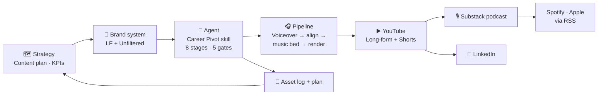

<div align="center">

# 🎙️ AI Content Ops Agent
### One voice recording → a video, Shorts, a podcast episode and posts across 6 platforms, with a human approving every step

**AI Product Management** · Personal build · Career Pivot series · Nov 2026

[](https://www.youtube.com/playlist?list=PLba1tur-5-iU)
[](https://youtu.be/-xgSDyY_rVA)
[](https://lashawnfofung.substack.com/p/career-pivot-ep-3-from-nurse-to-scrum)
[](https://github.com/LashawnFofung/AI-Portfolio)

</div>

---

## Contents
[TL;DR](#tldr) · [The Problem](#the-problem) · [The Product](#the-product) · [Key Product Decisions](#key-product-decisions) · [Architecture](#architecture) · [What's in This Repo](#whats-in-this-repo) · [Tech Stack](#tech-stack) · [My Role](#my-role) · [Roadmap](#roadmap)

---

## TL;DR

| | |
|---|---|
| **User** | Me: a working Technical PM publishing a weekly series about my move from nursing to tech to product |
| **Problem** | One episode means a script, voiceover, video, Shorts, thumbnails, a podcast and posts on 6 platforms. Doing it by hand takes most of a weekend. |
| **Solution** | An AI agent (a Claude skill) runs 8 stages from interview to cross-linked release. I answer questions, record my voice and approve. |
| **Proof** | 5 human approval gates. The agent never publishes on its own, and the gates have already caught a misleading line before it went live. |
| **Outcome** | Career Pivot Ep. 3 shipped to YouTube, Substack, Spotify and Apple Podcasts, every platform linked to the others |

---

## The Problem

A solo creator with a full-time job has three problems:

1. **Too many formats.** One idea has to become a long video, vertical Shorts, a podcast, images in 5 sizes and posts written for each platform.
2. **Consistency breaks.** Titles, branding and links drift across platforms when everything is done by hand.
3. **Speed vs. trust.** AI can draft fast, but public content in my name has to be accurate, in my words, and free of employer or patient details.

---

## The Product

An 8-stage agent workflow. The agent drafts and builds; I decide.

| Stage | Agent does | I do | Gate |
|---|---|---|---|
| **1. Interview** | Writes the episode doc and 5 interview questions | Answer by voice | ✅ Approve notes |
| **2. Script** | Writes a hook, 5 points and a close, plus a scene plan | Record one voice memo per part | ✅ Approve script |
| **3. Voiceover** | Cuts slates, tightens pauses, cleans and masters to −16 LUFS, aligns words to the script | | |
| **4. Video** | Builds the long-form (1920×1080) and 2 Shorts (1080×1920) with a ducked music bed, master −14 LUFS | Review renders | ✅ Approve renders |
| **5. Images** | Thumbnails (+ A/B variant), Short covers, square community image, Substack header, podcast art | | |
| **6. Publishing kit** | Titles, descriptions with chapters, community posts, poll, schedule | Upload to YouTube | ✅ Send the video link |
| **7. Packaging** | Substack podcast draft (feeds Spotify and Apple), LinkedIn post | Add the video file, publish | ✅ Approve each post |
| **8. Cross-link + log** | Links every platform to the others, updates the asset log and content plan | | |

---

## Key Product Decisions

| Decision | Why | Trade-off |
|---|---|---|
| **5 human approval gates; the agent never publishes** | Public content in my name must be accurate and in my voice (human-in-the-loop) | Each episode waits on me at 5 points |
| **Facts only from my interview answers** | Stops the AI from inventing dates, numbers or stories. Gaps become open questions. | Needs a real interview step before any script |
| **My own voice, not AI voice** | Credibility. The agent cleans and times my recordings instead of replacing them. | I have to record each part |
| **YouTube first, then package outward** | One master asset; Substack's podcast RSS feeds Spotify and Apple automatically | Other platforms wait until the video link exists |
| **Written guardrails in the skill** | No employer names, internal numbers or patient details, checked every episode | Some stories stay more general |
| **One brand system and title format** | "Career Pivot — Ep. N" and the same look on every platform build recognition | Less room for one-off designs |

---

## Architecture



| Layer | What it does |
|---|---|
| **Strategy** | Content plan, 90-day plan, KPIs and monetization strategy set what gets made |
| **Brand system** | Navy "LF" (professional) and green/orange "Unfiltered" (content) keep every asset consistent |
| **Agent** | The Career Pivot skill: stages, gates, specs and guardrails |
| **Pipeline** | Python + ffmpeg turn voice memos into mastered, timed audio and rendered video |
| **Distribution** | YouTube first, then Substack (Spotify and Apple via RSS) and LinkedIn |
| **Feedback** | The asset log and plan are updated after every release |

---

## What's in This Repo

| Path | What it is |
|---|---|
| [`skills/career-pivot-episode/SKILL.md`](skills/career-pivot-episode/SKILL.md) | The agent's instructions: stages, gates, specs and guardrails (a Claude skill) |
| [`pipeline/vo_master.py`](pipeline/vo_master.py) | Voiceover mastering: trim, de-noise, EQ, de-ess, compress, two-pass loudness to −16 LUFS |
| [`pipeline/vo_align.py`](pipeline/vo_align.py) | Removes the spoken slate, tightens long pauses with crossfades, gets word timings (pocketsphinx) |

**Run the audio pipeline** (Python 3.10+, `ffmpeg`, `numpy`, `pocketsphinx`):

```bash
pip install numpy pocketsphinx
# vo/map.json maps part numbers to your recordings: {"1": "part1.m4a", "2": "part2.m4a"}
python pipeline/vo_master.py   # → vo/01.wav, vo/02.wav … and vo/info.json (durations, pauses)
python pipeline/vo_align.py    # → vo/01_final.wav … with word timings added to vo/info.json
```

---

## Tech Stack

**Agent:** Claude (Anthropic) · Claude skills · browser automation for drafts
**Audio & video:** Python · ffmpeg · NumPy · pocketsphinx · Pillow
**Distribution:** YouTube · Substack (podcast RSS → Spotify, Apple Podcasts) · LinkedIn · GitHub

---

## My Role

**Product owner, designer and builder**

- **Product:** defined the problem, the 8-stage workflow, where AI acts vs. where I decide, and the guardrails.
- **Brand:** designed the two-brand system used across every platform.
- **Build:** wrote the agent skill and the audio/video pipeline with Claude as co-pilot.
- **Delivery:** shipped Career Pivot Ep. 3 across YouTube, Substack, Spotify and Apple Podcasts.

---

## Roadmap

- [x] Career Pivot Episode agent (Ep. 3 shipped Nov 2026)
- [ ] Track time saved and gate catches per episode
- [ ] n8n agents for Case Reps: Case Generator, Scorer, Scorecard Updater, voice Mock Interviewer

## Related Repos

- [Agentic Workflow Hub](https://github.com/LashawnFofung/Agentic-Workflow-Hub) — n8n agent builds
- [AI Portfolio](https://github.com/LashawnFofung/AI-Portfolio) · [MBA Portfolio](https://github.com/LashawnFofung/MBA-IT-Management-Portfolio)

<div align="center">

**Lashawn Fofung** · Technical Product Manager · [LinkedIn](https://www.linkedin.com/in/lashawnfofung/) · [Substack](https://lashawnfofung.substack.com/p/start-here) · [YouTube](https://www.youtube.com/playlist?list=PLba1tur-5-iU)

*Don't just do it. Learn it. Apply it. Grow it. Repeat.*

</div>
